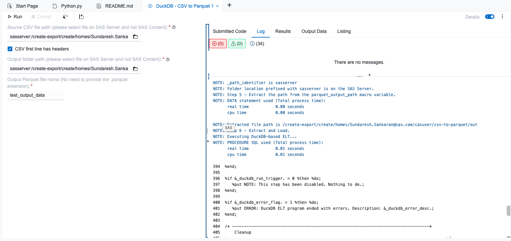

# CSV to Parquet 

## Description

> **“CSV to Parquet” is one of the most common conversion paths in modern data engineering pipelines.**

This custom step uses SAS/ACCESS Interface to DuckDB to ingest a source CSV file and convert it into an optimized Parquet file. 

Open file formats such as [Parquet](https://parquet.apache.org) offer benefits of reduced data footprint and columnar structure. [DuckDB](https://duckdb.org) is a popular and performant query processing engine that efficiently handles data ingestion and format conversion.

### Features
1. Ingest CSV with or without headers.
2. Save to Parquet on file system.
3. Save rejected records for downstream exception code if needed.

---
## User Interface

Watch a quick demo [here](https://www.youtube.com/watch?v=5ZlCy239wfE): https://www.youtube.com/watch?v=5ZlCy239wfE

---
## Requirements
- SAS Viya environment with SAS Studio flows
- SAS/ACCESS Interface to DuckDB configured on the compute server. Note that SAS supports DuckDB from monthly stable 2025.07 onwards.
---
## Usage

Configure the parameters as needed in the user interface parameters tab and run the step.

---
## Parameters
### Source Parameters
1. Source CSV file path (file selector, required): select the source CSV file located on the SAS server (filesystem). Note: please select files on the SAS Server and not SAS Content.
2. CSV first line has headers (checkbox, optional): indicate whether the first row of the CSV file contains column headers. Enabled by default.

### Target Parameters 
1. Output folder path (folder selector, required): select the destination folder location on the SAS server (filesystem) where the output Parquet file will be stored. Note: please select folders on the SAS Server and not SAS Content.
2. Output Parquet file name (text field, required): specify the name or prefix for the output Parquet file (no need to provide the `.parquet` extension).
3. Save Rejects (checkbox, default checked): Whether to save rejected records to a Parquet file in the same output directory or not.
4. Rejects table name (visible if Save Rejects selected): Specify name for the reject records table.
5. Rejects scan table name (visible if Save Rejects selected): Specify name for reject scan table holding metadata about rejects.

---
## Installation & Notes

This step is part of the `sas-studio-custom-steps` collection. Follow the repository instructions in the top-level README to make custom steps available in SAS Studio.

---
## Change Log

Reflects most recent update. For previous updates, refer detailed changelog [here](./extras/CHANGELOG.md).
- Version: 0.2.0 (02NOV2026)
    - Added Reject Saving Feature

---
## Contact
- [Sundaresh Sankaran](mailto:Sundaresh.Sankaran@sas.com)