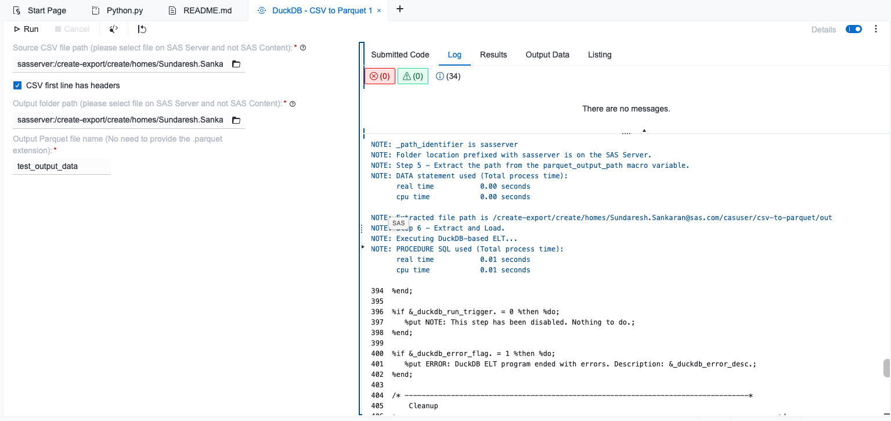

# DuckDB - CSV to Parquet Conversion

## Description
This custom step utilizes SAS/ACCESS Interface to DuckDB to ingest a source CSV file and convert it into an optimized Parquet file. Open file formats such as Parquet are popular due to the benefits they offer in reduced data footprint and columnar structure. DuckDB provides a popular and performant query processing engine that efficiently handles data ingestion and format conversion.

---
## User Interface

Watch a quick demo [here](https://www.youtube.com/watch?v=5ZlCy239wfE): https://www.youtube.com/watch?v=5ZlCy239wfE

---
## Requirements
- SAS Viya environment with SAS Studio flows
- SAS/ACCESS Interface to DuckDB configured on the compute server. Note that SAS supports DuckDB from monthly stable 2025.07 onwards.
---
## Usage

Configure the parameters as needed in the user interface parameters tab and run the step.

---
## Parameters
### Source Parameters
- Source CSV file path (file selector, required): select the source CSV file located on the SAS server (filesystem). Note: please select files on the SAS Server and not SAS Content.
- CSV first line has headers (checkbox, optional): indicate whether the first row of the CSV file contains column headers. Enabled by default.

### Target Parameters 
- Output folder path (folder selector, required): select the destination folder location on the SAS server (filesystem) where the output Parquet file will be stored. Note: please select folders on the SAS Server and not SAS Content.
- Output Parquet file name (text field, required): specify the name or prefix for the output Parquet file (no need to provide the `.parquet` extension).

---
## Installation & Notes

This step is part of the `sas-studio-custom-steps` collection. Follow the repository instructions in the top-level README to make custom steps available in SAS Studio.

---
## Change Log

Reflects most recent update. For previous updates, refer detailed changelog [here](./extras/CHANGELOG.md).
- Version: 0.1.0 (21OCT2026)
    - Initial release of the CSV to Parquet conversion custom step using DuckDB.
---
## Contact
- [Sundaresh Sankaran](mailto:Sundaresh.Sankaran@sas.com)