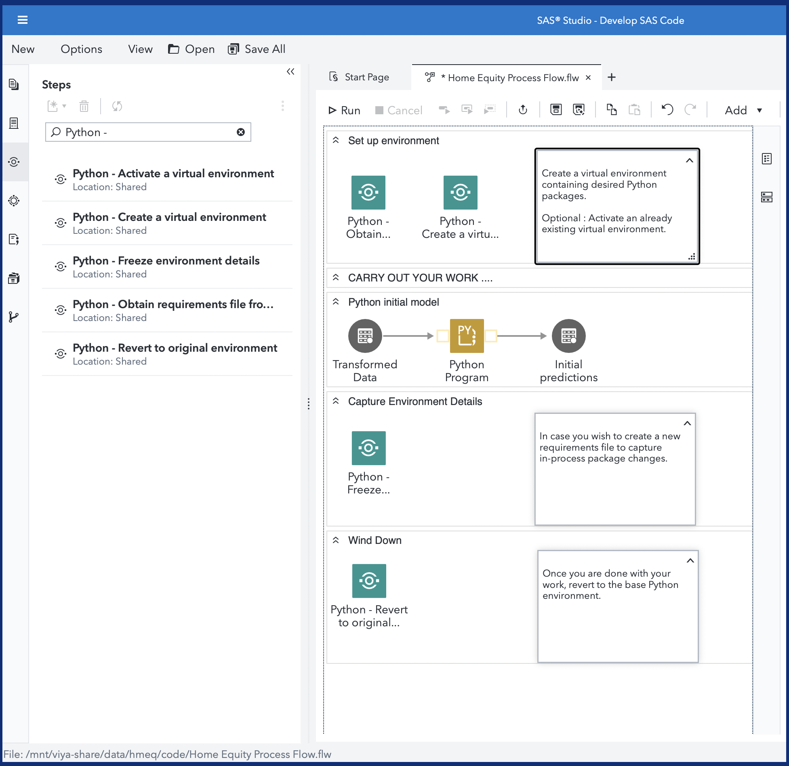
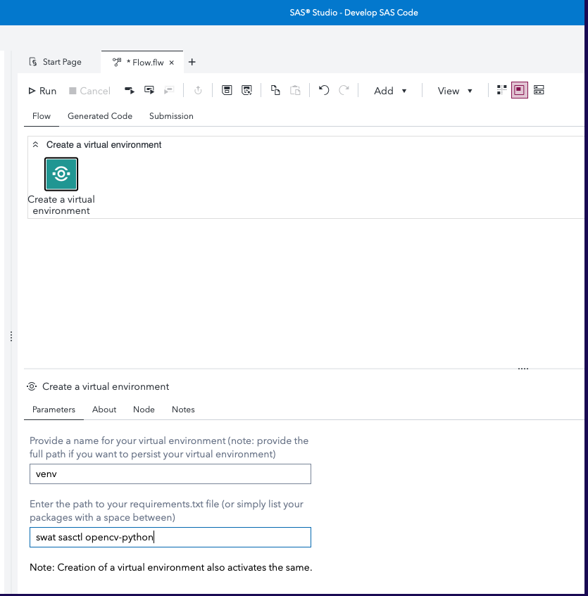

# Python - Create a Virtual Environment

## Description
Package your Python-based analytics solutions in a portable, repeatable, and reusable manner.  This SAS Studio custom step helps you create a virtual Python environments for use within SAS Viya. This enables ephemeral and isolated sessions.  

A general idea of how to use steps related to virtual environments:

A quick video: Click on this picture to watch this YouTube video. 

*Link: https://www.youtube.com/watch?v=RaiPOU0M278*

---
## User Interface
Refer the "About" tab on the step for more details.

### Parameters
This step helps you create a virtual environment. Input arguments required :
1. Path to your virtual environment (optional) : specify a full path to a persistent location on the filesystem, for future reuse
2. Requirements (optional) : either specify a path to a requirements.txt or enter them in space-delimited format.
3. Install system-site packages (checkbox): Keep this checked to ensure system-site packages from the base environment are also made available in the virtual environment. 
4. Install local Python packages (checkbox): Check this if you want to install local `.whl` files available in the folder system.
5. Local Python Packages folder (optional): If you've checked "I have local packages", then select a folder on the SAS Server filesystem (not SAS Content) which contains those `.whl` files. 

---
## Requirements

1. A SAS Viya 4 environment (last update on a monthly release 2026.05) with SAS Studio Flows
2. Python configured with the above environment (preferably using the [SAS Configurator for Open Source](https://go.documentation.sas.com/doc/en/itopscdc/v_016/itopswn/p19hj5ipftk86un1axa51rzr5mxv.htm))

---
## Installation & Usage

Refer to the [steps](../README.md#getting-started---making-a-custom-step-from-this-repository-available-in-sas-studio) listed in the main README.md

---
## The WHY :  Background information

Virtual Python environments in SAS Viya help data scientists create portable solutions,  maintain solution integrity, and exploit the integration between SAS and Python to the fullest extent.

- Read this [blog](https://blogs.sas.com/content/subconsciousmusings/2022/05/16/python-a-la-carte) for background.  

- [SAS & Open Source (Python) Integration : Better Together](https://www.youtube.com/watch?v=YVaX-A-ZsQ0&list=PLpe69msCs2C8IcarG0aEs_iKy4gyRSFPN&index=3)

- [Creating virtual Python environments within SAS Studio.](https://youtu.be/UIYZf2bKcWw)

---
## Change Log

* Version 3.0.0 (20NOV2026)
  - Added option to install local wheel files

Refer the `CHANGELOG.md` in the `extras` subfolder for earlier versions.

---
## Contact
- Sundaresh Sankaran ([sundaresh.sankaran@sas.com](mailto:sundaresh.sankaran@sas.com))

