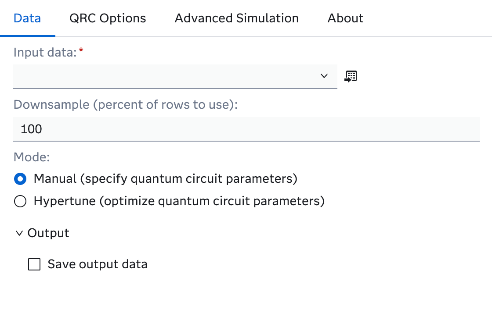
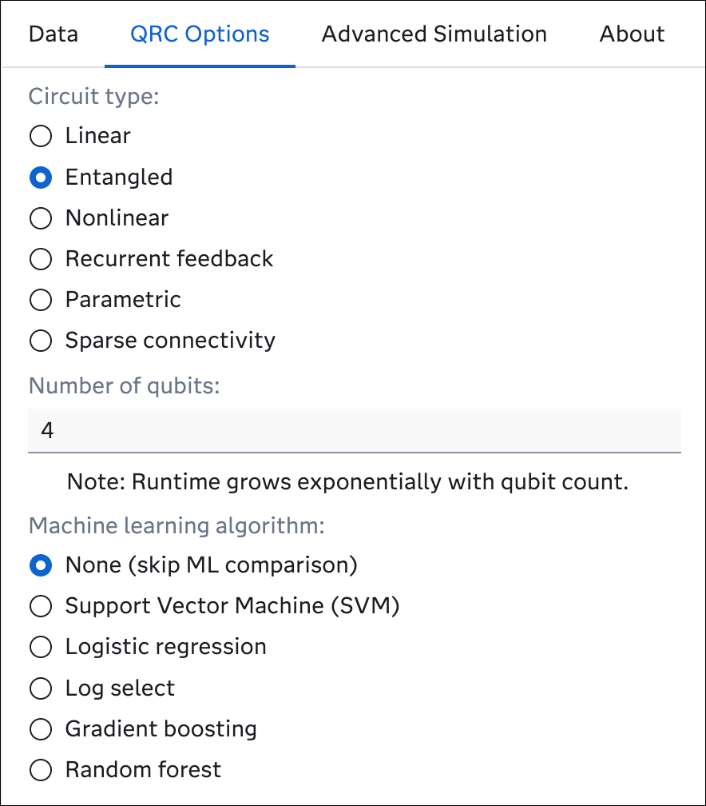
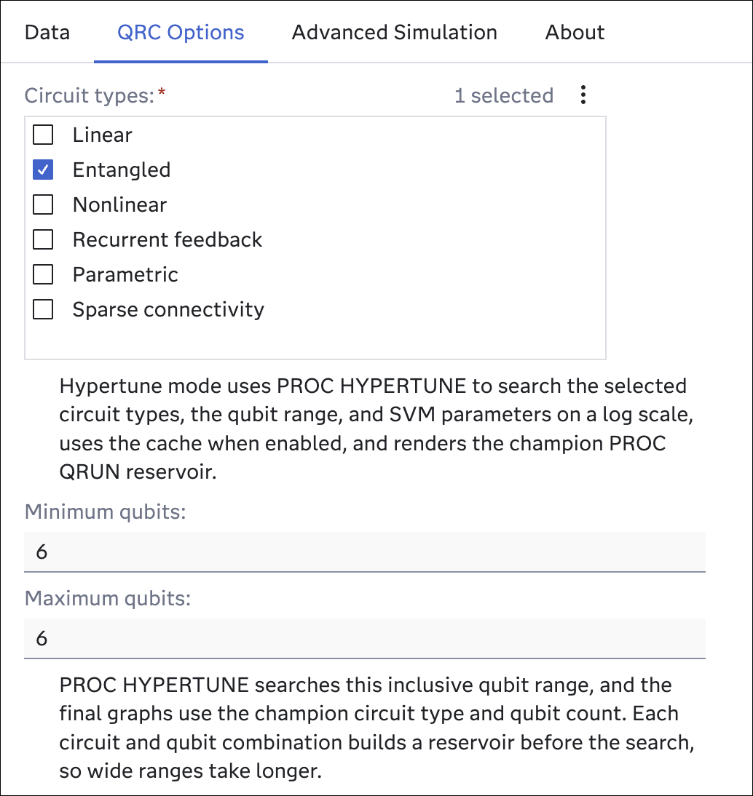
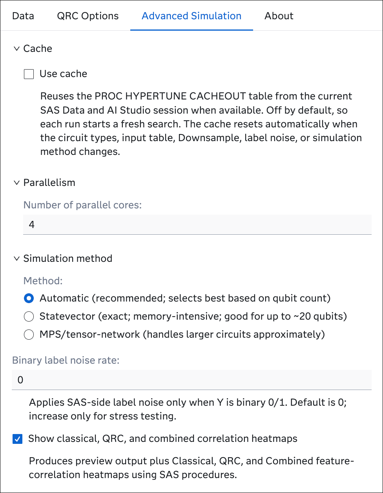
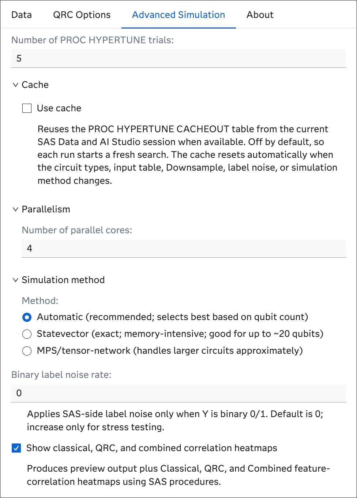
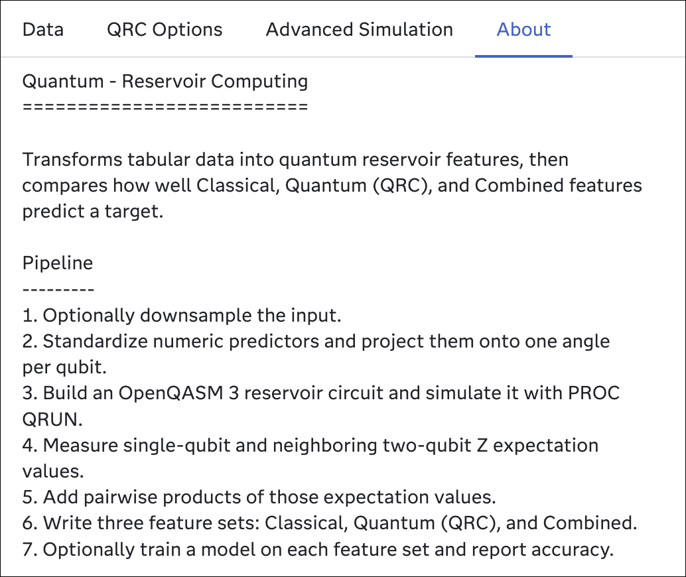
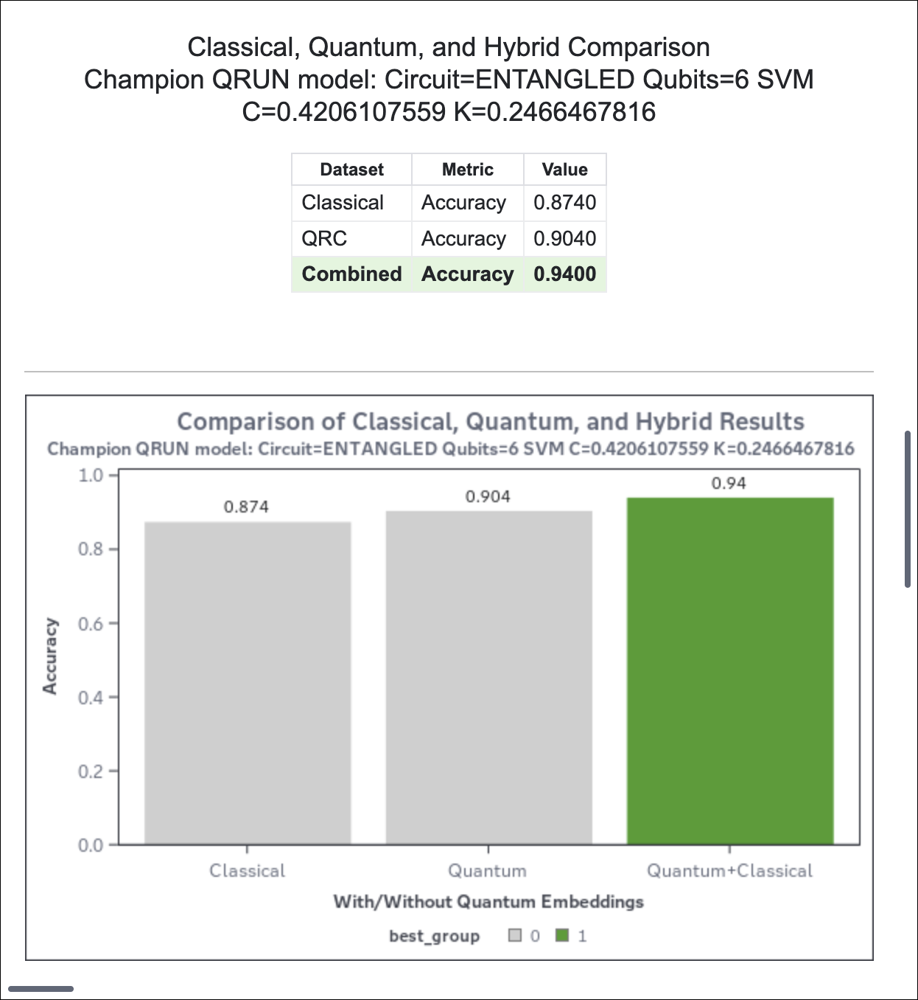

# Quantum - Reservoir Computing

## Description

The **Quantum - Reservoir Computing** custom step enables SAS Data and AI Studio users
to transform tabular data into quantum reservoir features.
It then compares how well classical, quantum, and combined features
predict a target.

The step runs the following pipeline:

1. Optionally downsamples the input table.
2. Standardizes the numeric predictors and projects them onto one angle
   per qubit.
3. Builds an OpenQASM 3 reservoir circuit and simulates it with
   `PROC QRUN`.
4. Measures single-qubit and neighboring two-qubit Z expectation values.
5. Adds pairwise products of those expectation values.
6. Writes three feature sets: Classical, Quantum (QRC), and Combined.
7. Optionally trains a classical model on each feature set and reports
   accuracy.

The step supports two modes:

| Mode | What it does |
| :--- | :--- |
| Manual | Runs one reservoir with the circuit type, qubit count, and simulation method you choose. |
| Hypertune | Uses `PROC HYPERTUNE` to search the circuit type, the qubit count, and the SVM parameters C and gamma, then regenerates the reservoir for the best result. |

Hypertune uses SAS SUBMIT objectives with `CACHEIN`, `CACHEOUT`, and
`PRIMALOUT` datasets.
It searches C and gamma on a log10 scale and uses **Number of parallel
cores** (`NumParallel`) for parallel evaluations.
The default search bounds are 0.0001 to 2 for C and 0.1 to 0.3 for gamma.
By default, Hypertune uses exactly 6 qubits and 5 trials.
The final circuit display, accuracy comparison, output data, and context
JSON are regenerated from the winning reservoir.
It does not use the original Python AutoQX optimizer or external Python cache.

## User Interface

### Data tab



| Control | Description |
| :--- | :--- |
| Input data | Required. Numeric columns are used as predictors. |
| Downsample (percent of rows to use) | Simple random sample of the input, 1 to 100. Default 100. |
| Mode | Manual or Hypertune. |
| Save output data | Writes the Combined feature table to the output port. |
| Output table | Name of the output table. Shown when **Save output data** is selected. Required in that case. |
| Replace existing output table | Shown when **Save output data** is selected. When cleared, the step stops with an error before running if the table already exists. |

The target column must be named `y` or `target` (case-insensitive).
If both exist, `y` is used.
If neither exists, a placeholder `y` of 0 is created,
so the ML comparison is not meaningful.
Missing numeric target values are set to 0.

### QRC Options tab

**Manual mode**



**Hypertune mode**



| Control | Mode | Description |
| :--- | :--- | :--- |
| Circuit type | Manual | Linear, Entangled, Nonlinear, Recurrent feedback, Parametric, or Sparse connectivity. |
| Circuit types | Hypertune | Multi-select list of the same circuits. Hypertune searches the selected circuits. |
| Number of qubits | Manual | Default 6. |
| Minimum qubits, Maximum qubits | Hypertune | Qubit search range. Defaults 6 to 6. |
| Machine learning algorithm | Both | Manual: None, SVM, Logistic regression, Log select, Gradient boosting, or Random forest. Hypertune: fixed to SVM (selection disabled). |
| C, Gamma | Manual | SVM regularization and RBF kernel bandwidth. |
| C minimum and maximum, Gamma minimum and maximum | Hypertune | SVM search bounds, searched on a log10 scale. |
| Classification threshold | Manual | Used by Logistic regression and Log select. |

The tab also contains gradient boosting and random forest settings
and a logistic variable selection method.
The step marks these as not applied.
See **Limitations** for which settings affect the results.

**Classification threshold** appears for both Logistic regression and
Log select.

### Advanced Simulation tab

**Manual mode**



**Hypertune mode**



| Control | Description |
| :--- | :--- |
| Number of PROC HYPERTUNE trials | Hypertune only. Default 5. |
| Use cache | Reuses the `PROC HYPERTUNE` cache from the current session. The cache resets automatically when the circuit list, input table, Downsample, label noise, or simulation method changes. Default off. |
| Number of parallel cores | Threads for `PROC QRUN` and parallel Hypertune evaluations. Default 4. |
| Simulation method | Automatic, Statevector, or MPS. |
| Binary label noise rate | Randomly flips binary 0/1 labels at this rate to stress test. Default 0. |
| Show correlation heatmaps | Classical, QRC, and Combined feature-correlation heatmaps. Default on. |

### About tab



Summary of the modes, outputs, and algorithms,
with collapsible Pre-requisites and Documentation sections
and the version history.

## Output

* **Results window:** The champion circuit display, a runtime summary,
  and an accuracy comparison table and bar chart for Classical, Quantum,
  and Quantum+Classical features.
  The accuracy comparison appears when a machine learning algorithm is
  selected.
  Heatmaps appear when selected.
* **Output port (optional):** The Combined feature table.
  It has columns `x0`, `x1`, and so on
  (classical projections followed by quantum features), plus `y`.
* **Files in the SAS session working directory:**
  Each run writes files whose names include a unique run identifier.
  * `classical_*.csv`, `qrc_*.csv`, and `combined_*.csv`
  * `accuracy_*.csv`
  * `circuit_*.qasm3`
  * `agent_context_*.json`, which records the run settings and file
    names

When it finishes, the step deletes its temporary `_qrc_` tables from
WORK and from the `qrun` library, its global macro variables, and its
macros, and it restores the `MLOGIC`, `MPRINT`, and `SYMBOLGEN` options.
With **Use cache** selected, the `PROC HYPERTUNE` cache table is kept.

### Example output

This example uses `WORK.EXAMPLE_DATA`, with 500 rows, 40 numeric predictors,
and a binary target.
The step ran in Hypertune mode with an Entangled six-qubit reservoir and
five trials.
The displayed accuracies are training scores, not held-out performance.



## Requirements

* SAS Viya with SAS Data and AI Studio Flows.
* A release that includes `PROC QRUN` (SAS Quantum Lab) and `PROC HYPERTUNE`.
* An active CAS session.
  The step assigns a `qrun` CAS library, starting a `qrun_session` if
  needed, to hold intermediate tables for `PROC QRUN`.
* Numeric predictor columns and a `y` or `target` column.
* A Python environment configured for `PROC HYPERTUNE`.

Tested on Viya version 2026.11.

## Usage

Use a table with numeric predictors and a binary `y` column.
The following program creates a small example in `WORK`:

```sas
data work.qrc_demo;
    call streaminit(42);
    do i = 1 to 500;
        x1 = rand('normal');
        x2 = rand('normal');
        x3 = rand('normal');
        x4 = rand('normal');
        y = (x1 * x2 + 0.5 * x3 > 0);
        output;
    end;
    drop i;
run;
```

1. Add the **Quantum - Reservoir Computing** step to a flow,
   or open it on its own.
2. Select `WORK.QRC_DEMO` as the input data.
3. Keep Manual mode.
4. On the **QRC Options** tab, set **Machine learning algorithm** to
   **Support Vector Machine (SVM)**.
5. Run the step.

The comparison table shows accuracy for Classical, Quantum, and
Quantum+Classical features.
The comparison is on training data, not held-out data.
To pass the Combined features downstream, select **Save output data**
and connect the output port.

## Limitations

* Reported accuracy is training accuracy, not held-out accuracy.
  For a binary target, the SVM result is the better of the SVM and a
  nearest-centroid classifier.
* **Simulation method:** **Statevector** and **MPS** set `SIMMETHOD=` on
  the `PROC QRUN` call.
  Automatic runs with the default method.
* **Hypertune:** Hypertune always tunes SVM.
  The classification threshold, gradient boosting, and random forest
  bounds are not searched.
* **Gradient boosting, random forest, and logistic selection:**
  These models run with procedure defaults.
  The tree and forest parameters and the variable selection method on the
  **QRC Options** tab are not applied.
  Logistic regression and Log select run the same model;
  only the threshold applies.
* **Hypertune circuits:** Hypertune searches the circuits selected in the
  **Circuit types** list.
  If none is selected, it uses Entangled.
* **Hypertune cache:** With **Use cache** selected, the cache resets when
  the circuit list, input table name or row count, Downsample, label
  noise, or simulation method changes.
  It cannot detect changed values in a table with the same name and row
  count.
* **Noiseless simulation:** Quantum simulation has no simulated gate or
  hardware noise.
  `OBSERVE` omits `shots=`, so expectation values are computed from the
  simulated state without measurement-shot sampling.
  Optional binary label noise affects only classification targets,
  not the quantum circuit.
* **Binary label noise:** Applies only when `y` contains both 0 and 1.
  Each label is flipped with the specified probability, using seed 42.
  Default 0 leaves labels unchanged.
  The modified labels are used by all three feature sets and Hypertune.
  The SAS log reports whether label noise was applied or skipped.
* **Qubit count:** The number of projected predictors is the smaller of
  the qubit count and the number of numeric predictors.
  Extra qubits receive an angle of 0.
* **Large settings:** The step does not limit the qubit count.
  It writes a warning to the log for more than 20 qubits without MPS,
  more than 500 quantum features per row,
  or more than 12 Hypertune candidate reservoirs.
  The feature count grows quadratically with the qubit count.

## Change Log

* Version 1.0 (17NOV2026)
  * Initial version.
