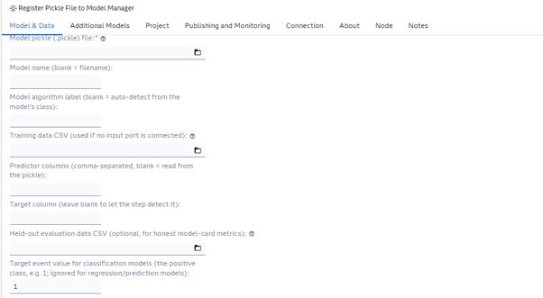
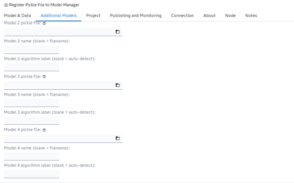
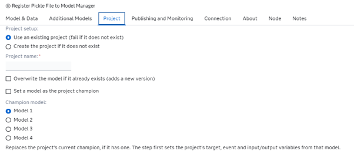
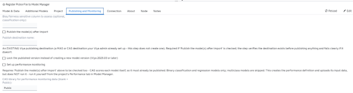
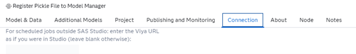
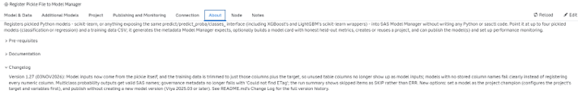

# Register Pickle File to Model Manager

## Description

The **Register Pickle File to Model Manager** custom step registers pickled Python models — scikit-learn, or anything exposing the same `predict`/`predict_proba`/`classes_` interface (including XGBoost's and LightGBM's scikit-learn wrappers) — trained entirely outside SAS, into SAS Model Manager, without writing any Python or sasctl code yourself.

Point the step at up to four pickled models (classification or regression) and training data — either a CSV, or a table already in Viya connected as an input port — and it will:

* Auto-detect predictor columns from each model's own trained feature list (or let you specify them explicitly), and auto-detect whether each model is classification or regression/prediction directly from the pickle itself
* Handle binary **and** multiclass classification, as well as regression/prediction models, in the same batch
* Generate the information Model Manager needs about the model’s inputs and outputs, along with model properties and governance/lineage metadata (who registered it, when, the framework, and the model's hyperparameters)
* Optionally generate a full model card, including honest held-out metrics if an evaluation dataset is supplied, and an optional bias/fairness assessment against a sensitive column
* Create the target Model Manager project if it doesn't already exist, or register into an existing one
* Optionally publish the imported model(s) to an existing Viya publishing destination, verifying the destination exists before doing any work, and confirming the publish job actually completed rather than just submitting it
* Optionally set up performance monitoring for the imported model(s), once published

Up to four models share one training table, one target column, and one project — so a single run of the step can recreate a typical "compare several algorithms on the same problem" workflow (e.g. a decision tree, a random forest, and a gradient boosting model, all predicting the same target) entirely from the UI.

Models are picked up either from a SAS Content location or directly from the compute server's filesystem — the step stages SAS Content files into WORK automatically before reading them.

## Requirements

### SAS Viya and model compatibility

* Tested on Viya Stable 2026.06.
* Tested with scikit-learn models. Other scikit-learn-API-compatible libraries (e.g. XGBoost and LightGBM) are expected to work but have not yet been verified; broadening tested coverage is planned.

### Python environment

The step runs its Python code in the SAS Studio compute session's `proc python` block. These packages must already be available in that session's Python environment; the step does not install them:

* `sasctl` (including the `pzmm` submodule)
* `pandas`
* `scikit-learn`
* `swat` and `certifi` if you use the SAS Content file picker or performance monitoring. Those features upload data directly to CAS and use SWAT's SSL certificate configuration. These packages are not needed for `sasserver:`-style paths when neither feature is used.

### Optional feature configuration

* **Publishing:** Choose a publishing destination that’s already set up in Viya. Creating one is an admin-only operation and is outside the scope of this step.
* **Performance monitoring:** This option requires **Publish** to be enabled, because Model Manager scores the published model to compute performance. The step creates the performance definition but does not run it. Run it from the project's **Performance** tab instead: results are written to a Model Manager library shared across projects, and leftover results from a previous job that didn’t finish anywhere on the server can cause a "target table ... already exists" error. The step cannot detect or clean up leftover results; running the job from Model Manager keeps the failure retryable and separate from the step run.

## User Interface

1. ### Input Parameters ###

   The core inputs:

   1. The first model's pickle file
   2. An optional name and algorithm label (auto-detected from the model's class if left blank)
   3. Training data: connect a table already in Viya (CAS-backed or a classic SAS library) as an input port, or a training data CSV if nothing's connected to the port
   4. Optional explicit predictor columns (auto-detected from the model if left blank)
   5. The target column (optional, auto-detected from the training table if left blank)
   6. An optional held-out evaluation dataset for honest model-card metrics
   7. For classification models only: which class value is the target "event" (whether each model is classification or regression/prediction is detected automatically from the pickle; there's no field for it)

   

2. ### Additional Models ###

   Optionally, up to three more models, each sharing the same training table, target, and project as the first model:

   1. Pickle file
   2. Name
   3. Algorithm label

   

3. ### Project ###

   Whether to require an existing project or create one if it's missing, the project name, and whether re-running should overwrite an existing model version.

   

4. ### Publishing and Monitoring ###

   A model card is always generated; optionally give a sensitive column for a bias/fairness assessment (classification only).

   Whether to publish the imported model(s), and the name of the (already-existing) Viya publishing destination to publish to. The destination is verified up front — the step fails immediately with a clear message (and the list of destinations that *do* exist) if it can't find the one you named, rather than partway through the run.

   Also whether to set up performance monitoring for the imported model(s) — binary classification and regression/prediction models only, multiclass models are skipped — and which CAS library to upload the monitoring input table to (default `Public`). This requires **Publish** to be checked too: SAS Model Manager scores each model itself to compute performance, so the model has to already be published for that to work. This option configures the project's Model Evaluation properties, uploads a monitoring input table, and creates the performance definition, including drift-alert thresholds set automatically to SAS's recommended defaults — it deliberately does **not** run the performance job itself (see Requirements below for why). Once the step finishes, open the project's **Performance** tab in Model Manager and click **Run** on the definition it created.

   

5. ### Connection ###

   An optional explicit Viya host, only needed if the step can't derive one automatically from the SAS Studio session it's running in.

   


6. ### About ###

   General description of the step, plus collapsible **Prerequisites** and **Documentation** sections and an expanded **Change Log** section showing the current version — kept in sync with the Requirements and Change Log sections of this README.

   

## Usage

The step expects a plain CSV training table and one or more pickled scikit-learn models trained on it. A quick way to produce both from data already available in your Viya environment:

1. Export `SASHELP.CARS` to CSV (or use any tabular dataset with a mix of numeric predictors and a target column).
2. In a local Python environment (not necessarily SAS Studio), train a simple scikit-learn model against it and pickle the result, e.g.:

   ```python
   import pickle
   from sklearn.ensemble import RandomForestClassifier
   from sklearn.model_selection import train_test_split

   # X, y loaded from your exported CSV, target is a binary column
   X_train, X_test, y_train, y_test = train_test_split(X, y, test_size=0.3, random_state=42)
   model = RandomForestClassifier(random_state=42).fit(X_train, y_train)

   with open("model.pickle", "wb") as f:
       pickle.dump(model, f)
   ```

3. Upload `model.pickle` and the training CSV somewhere SAS Studio's file picker can reach them (a SAS Content folder, or a path on the compute server).
4. Add the **Register Pickle File to Model Manager** step to a flow, point **Model & Data** at the pickle and the CSV, name your target column, and run it.
5. Check SAS Model Manager — the project (created if it didn't exist) should now contain the registered model, with a model card if you left that option checked.

The log ends with a summary showing whether each step succeeded or had an error, so a problem with one model in a multi-model batch is easy to spot without blocking the rest.

### Running it without the step's UI

`extras/Register Pickle File to Model Manager.sas` contains the exact same logic as the custom step, with the UI fields exposed as `%let` statements at the top instead. Fill those in and submit the file directly in a SAS Studio Program tab (or any batch/scheduled SAS session) to run it without importing the custom step — useful for repeated or scripted runs. The training-data input port is a Flow-only feature (it depends on the Flow Designer's own port resolution), so this standalone script always reads training data from the CSV `%let`.

## Change Log

* Version 1.26 (29OCT2026)
    * Training data can now come from a connected input port instead of only a CSV, per PR review feedback from Sundaresh — a table already in Viya (CAS-backed, or a classic SAS library like `SASHELP`) can be wired directly into the step instead of exporting it to a file first. The port is optional: with nothing connected, the step behaves exactly as before, reading the training CSV field. Verified live against a CAS-backed table, a classic SAS library table, and a CSV-only run with the port disconnected.
        * Implementation note: the connected table's SAS libref is **not** the same as its real CAS caslib name — confirmed live, handing the libref straight to `swat`'s `CASTable(caslib=...)` fails with "caslib does not exist", and `pathname()` on the libref (the usual way to resolve a CAS libref) returns an internal table GUID, not a usable caslib name either. The fix reads the table through the SAS session itself instead — `SAS.submit()` stages it into `WORK`, then `SAS.sd2df()` reads it — which works identically whether the connected table is CAS-backed or a classic SAS library, with no caslib resolution needed at all.

Previous releases are documented in [extras/CHANGELOG.md](extras/CHANGELOG.md).
