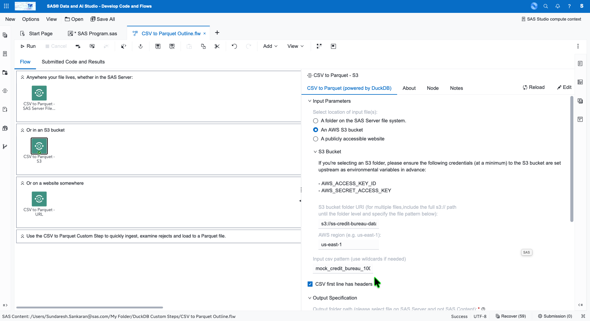

# CSV to Parquet 

:::note[**ACCESS THE CUSTOM STEP FOLDER**]

[CSV to Parquet](https://github.com/sassoftware/sas-studio-custom-steps/tree/main/CSV%20to%20Parquet)

:::

:::info[Features]
1. Ingest CSV with or without headers.
2. Ingest CSV from 3 source areas: SAS Server, S3 buckets and URLs
3. Save to Parquet on file system.
4. Save rejected records for downstream exception code if needed.
5. Unify multiple schemas if required
:::

## Description

“CSV to Parquet” is one of the most common conversion paths in modern data engineering pipelines.

This custom step uses SAS/ACCESS Interface to DuckDB to ingest a source CSV file and convert it into an optimized Parquet file. 

Open file formats such as [Parquet](https://parquet.apache.org) offer benefits of reduced data footprint and columnar structure. [DuckDB](https://duckdb.org) is a popular and performant query processing engine that efficiently handles data ingestion and format conversion.

---
## User Interface

Watch a quick demo 

https://www.youtube.com/watch?v=5ZlCy239wfE

---
## Requirements
- SAS Viya environment with SAS Data and AI Studio flows
- SAS/ACCESS Interface to DuckDB configured on the compute server. Note that SAS supports DuckDB from monthly stable 2025.07 onwards.
---
## Usage

Configure the parameters as needed in the user interface parameters tab and run the step.

---
## Parameters
### Source Parameters
1. Location of input files (radio button group, default folder): Select where your source input files are located.

#### Folder options:
===========

2. Source CSV file path (folder selector, required): select the folder containing source CSV files located on the SAS server (filesystem). Note: please select a folder on the SAS Server and not SAS Content.

#### S3 Bucket Options:
===============

3. S3 Bucket folder path (text field): Specify the S3 bucket where your CSV files are located.  If ingesting multiple files, specify only till the folder level, i.e. excluding the filename pattern and extension.  If you choose to include the filename pattern, ensure that the CSV filename pattern field is blank.

4. S3 region (text field, default us-east-1): Specify the AWS region.

Important - check the following prerequisites for S3

- Ensure you have set the following environmental variables to hold S3 bucket credentials.  These are identified by 
  the credential_chain provider in DuckDB automatically.  At a minimum,
  - AWS_ACCESS_KEY_ID
  - AWS_SECRET_ACCESS_KEY
  and if you're using short-term tokens for the session, 
  - AWS_SESSION_TOKEN

  A standard way is to set options through option set=VAR=VALUE; SAS statements. Refer this [page](https://github.com/sassoftware/sas-studio-custom-steps/tree/main/CSV%20to%20Parquet/extras/AWS_Credentials.md) for more details.

#### URL (file hosted on the web) options:
============================

5. URL path (text field): Provide the full path to a single CSV file on the web.  Do not include a glob (*) pattern. The CSV file pattern field is automatically hidden when you use this option.

----

6. File pattern (text field, default *.csv): A glob pattern which may include wildcards describing source CSV files

7. CSV first line has headers (checkbox, optional): indicate whether the first row of the CSV file contains column headers. Enabled by default.

### Target Parameters 

1. Output folder path (folder selector, required): select the destination folder location on the SAS server (filesystem) where the output Parquet file will be stored. Note: please select folders on the SAS Server and not SAS Content. 
2. Output Parquet file name (text field, required): specify the name or prefix for the output Parquet file (no need to provide the .parquet extension). 
3. Save Rejects (checkbox, default checked): Whether to save rejected records to a Parquet file in the same output directory or not. 
4. Rejects table name (visible if Save Rejects selected): Specify name for the reject records table. 
5. Rejects scan table name (visible if Save Rejects selected): Specify name for reject scan table holding metadata about rejects. 
6. Ignore Errors (checkbox, default false): skip rows that cause parsing or casting errors 
7. Combine multiple file schemas (checkbox, default false): whether to combine multiple schemas based on column names - this corresponds to union_by_name in the DuckDB read_csv() function.

---
## References 
1. [Writing Parquet files using DuckDB](https://duckdb.org/docs/2.0/data/parquet/overview)
2. [Reading CSV using DuckDB](https://duckdb.org/docs/2.0/guides/file_formats/csv_import)
3. [SAS/Access Interface to DuckDB](https://go.documentation.sas.com/doc/en/pgmsascdc/v_080/acreldb/p1fekl0cwbnzcmn1026kzjequme4.htm)

---
## Installation & Notes

This step is part of the `sas-studio-custom-steps` collection. Follow the repository instructions in the top-level README to make custom steps available in SAS Studio.

---
## Change Log

Reflects most recent update. For previous updates, refer detailed changelog [here](https://github.com/sassoftware/sas-studio-custom-steps/tree/main/CSV%20to%20Parquet/extras/CHANGELOG.md).
- Version: 1.0.0 (23NOV2026)
    - Version 1.0.0 with multiple source options, read options and target specification.

---
## Contact
- [Sundaresh Sankaran](mailto:Sundaresh.Sankaran@sas.com)
