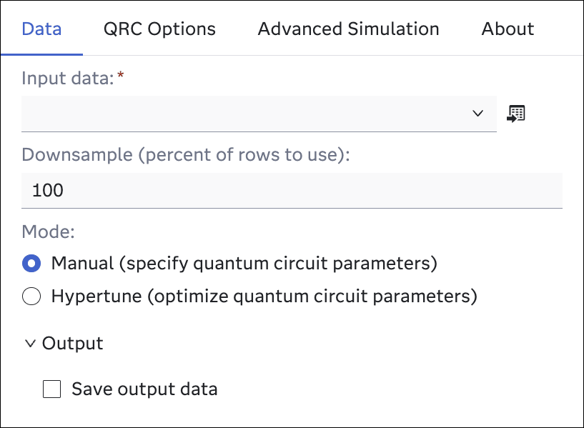
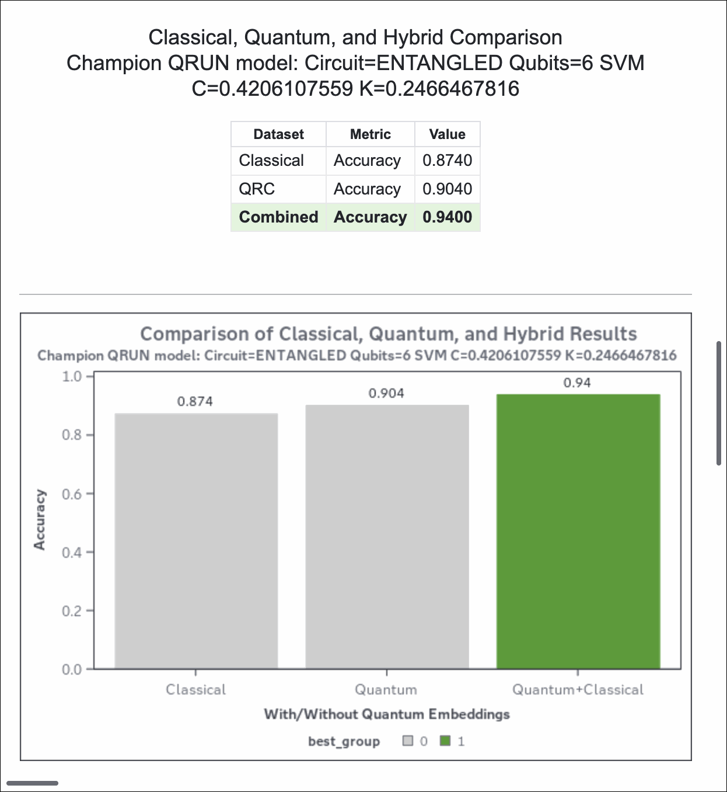

# Quantum - Reservoir Computing

:::note[**ACCESS THE CUSTOM STEP FOLDER**]

[Quantum - Reservoir Computing](https://github.com/sassoftware/sas-studio-custom-steps/tree/main/Quantum%20-%20Reservoir%20Computing)

:::


## Description

The **Quantum - Reservoir Computing** custom step enables SAS Data and AI Studio users
to transform tabular data into quantum reservoir features.
It then compares how well classical, quantum, and combined features
predict a target.

The step runs the following pipeline:

1. Optionally downsamples the input table.
2. Standardizes the numeric predictors and projects them onto one angle
   per qubit.
3. Builds an OpenQASM 3 reservoir circuit and simulates it with
   `PROC QRUN`.
4. Measures single-qubit and neighboring two-qubit Z expectation values.
5. Adds pairwise products of those expectation values.
6. Writes three feature sets: Classical, Quantum (QRC), and Combined.
7. Optionally trains a classical model on each feature set and reports
   accuracy.

## Requirements

* SAS Viya 4 2026.11 or later with SAS Data and AI Studio.
  SAS Viya 4 2026.11 is the first release that includes SAS Quantum and
  `PROC QRUN`; it also includes `PROC HYPERTUNE`.
* An active CAS session.
  The step assigns a `qrun` CAS library, starting a `qrun_session` if
  needed, to hold intermediate tables for `PROC QRUN`.
* Numeric predictor columns. For a meaningful model comparison, include a
  numeric `y` or `target` column.
* For Hypertune mode, a Python environment configured for `PROC HYPERTUNE`.

Tested on SAS Viya 4, release 2026.11.

## References

* [Quantum reservoir computing](https://en.wikipedia.org/wiki/Reservoir_computing#Quantum_reservoir_computing)
* [SAS Quantum Lab: User's Guide](https://go.documentation.sas.com/doc/en/pgmsascdc/default/quantug/titlepage.htm)
* [PROC QRUN](https://go.documentation.sas.com/doc/en/sasstudiocdc/default/pgmsascdc/quantug/p0pjqw4abqy460n1txt0zuo4688z.htm?requestorId=048ea242-2df3-4a17-9c10-14246a25d37b)
* [PROC HYPERTUNE](https://helpcenter.unx.sas.com/test/doc/en/sasstudiocdc/default/pgmsascdc/quantug/p0i7h93aeue5wkn1bf8m58yvaky0.htm?requestorId=048ea242-2df3-4a17-9c10-14246a25d37b)

## User Interface

### Modes

| Mode | What it does |
| :--- | :--- |
| Manual (default) | Runs one reservoir with the circuit type, qubit count, and simulation method you choose. |
| Hypertune | Uses `PROC HYPERTUNE` to search the circuit type, the qubit count, and the SVM parameters C and gamma, then regenerates the reservoir for the best result. |

Hypertune uses SAS SUBMIT objectives with `CACHEIN`, `CACHEOUT`, and
`PRIMALOUT` datasets.
It searches C and gamma on a log10 scale and uses **Parallel cores** for
parallel evaluations.
The default search bounds are 0.0001 to 2 for C and 0.1 to 0.3 for gamma.
By default, both modes use the Entangled circuit and 6 qubits. Hypertune
defaults to 5 trials.
The final circuit display, accuracy comparison, output data, and context
JSON are regenerated from the winning reservoir.
It does not use the original Python AutoQX optimizer or external Python cache.

### Data tab



| Control | Description |
| :--- | :--- |
| Input data | Required. Numeric columns are used as predictors. |
| Downsample (percent of rows to use) | Simple random sample of the input, 1 to 100. Default 100. |
| Mode | Manual or Hypertune. See [Modes](#modes). |
| Save output data | Writes the Combined feature table to the output port. |
| Output table | Name of the output table. Shown when **Save output data** is selected. Required in that case. |
| Replace existing output table | Shown when **Save output data** is selected. When cleared, the step stops with an error before running if the table already exists. |

Name the target column `y` or `target` (case-insensitive).
If both exist, `y` is used. If neither exists, a placeholder `y` of 0 is created, so the ML comparison is not meaningful.
Missing numeric target values are set to 0.

### QRC Options tab

Both modes use **Reservoir settings** and **Model settings**. In Manual mode,
choose one circuit and a qubit count, then choose a model or select **None** to
generate features without training. In Hypertune mode, choose one or more
circuits and a qubit range, then set the search bounds for C and gamma. Hypertune
uses SVM only.

| Control | Mode | Description |
| :--- | :--- | :--- |
| Circuit type | Manual | Linear, Entangled, Nonlinear, Recurrent feedback, Parametric, or Sparse connectivity. |
| Circuit types | Hypertune | Select one or more circuits to search. |
| Number of qubits | Manual | 4 to 30. Default 6. |
| Minimum number of qubits, Maximum number of qubits | Hypertune | Inclusive search range, within 4 to 30. Set both limits to the same value to search a fixed count. Both default to 6. |
| Machine learning algorithm | Manual | None (default), SVM, Logistic regression, Log select, Gradient boosting, or Random forest. Only the selected model's settings are shown. |
| C, Gamma | Manual | SVM regularization strength and RBF kernel coefficient. |
| C minimum and maximum, Gamma minimum and maximum | Hypertune | SVM search bounds, searched on a log10 scale. |
| Classification threshold | Manual | Converts predicted probabilities to class labels for Logistic regression and Log select. It does not change the fitted model. |
| Variable selection method | Manual | Log select only: Forward, Backward, or Stepwise (default). Logistic regression fits all predictors without selection. |
| Gradient boosting parameters | Manual | Number of trees, learning rate, maximum depth, and minimum leaf size. |
| Random forest parameters | Manual | Number of trees, interval bins, and minimum leaf size. |

### Advanced Simulation tab

| Section | Settings |
| :--- | :--- |
| Simulation | **Simulation method** defaults to Automatic. Choose Statevector for exact simulation or Matrix product state (MPS) for a method that can handle larger circuits approximately. **Parallel cores** controls the threads for `PROC QRUN` and parallel Hypertune evaluations. Default 4. |
| Hypertune search | Visible only in Hypertune mode. **Number of trials** defaults to 5. **Use cache** reuses eligible `PROC HYPERTUNE` trial results from the current SAS session. Default off. See [Limitations](#limitations) for when the cache resets. |
| Results | **Show correlation heatmaps** shows a preview of the first 10 rows of QRC features and writes Pearson correlation heatmaps for the Classical, QRC, and Combined feature sets to an HTML file. Default on. |
| Stress testing | Collapsed by default. **Binary label noise rate** sets the probability of flipping each label when the target contains both 0 and 1. Leave it at 0 to keep labels unchanged. |

### About tab

Summary of the modes, tab settings, outputs, and algorithms,
with collapsible Pre-requisites and Documentation sections
and the version history.

## Output

* **Results window:** The selected circuit (the winning circuit in Hypertune),
  a runtime summary,
  and an accuracy comparison table and bar chart for Classical, Quantum,
  and Quantum+Classical features.
  The accuracy comparison appears when a machine learning algorithm is
  selected.
* **Output port (optional):** The Combined feature table.
  It has columns `x0`, `x1`, and so on
  (classical projections followed by quantum features), plus `y`.
* **Files in the SAS session working directory:**
  Output filenames include a unique identifier.
  * `classical_*.csv`, `qrc_*.csv`, and `combined_*.csv`
  * `accuracy_*.csv` when a model accuracy table is available
  * `circuit_*.qasm3` when a circuit file is available
  * `qrc_heatmaps_*.html` when **Show correlation heatmaps** is selected
  * `agent_context_*.json`, which records the run settings and file
    names

When it finishes, the step deletes its temporary input CSV, working circuit
file, and Hypertune submit file, and clears its file references. It removes its
intermediate WORK and CAS tables, macro variables, and macros, and restores the
`MLOGIC`, `MPRINT`, `SYMBOLGEN`, and `SYNTAXCHECK` options. It releases the
`qrun` library and CAS session only if it opened them. The output table and
exported results are kept.
Manual runs leave any existing `PROC HYPERTUNE` cache untouched.
Hypertune runs keep the cache only when **Use cache** is selected.

### Example output

This example uses `WORK.EXAMPLE_DATA`, with 500 rows, 40 numeric predictors,
and a binary target.
The step ran in Hypertune mode with an Entangled six-qubit reservoir and
five trials.
The displayed accuracies are training scores, not held-out performance.



## Usage

Use a table with numeric predictors and a binary `y` column.
The following program creates a small example in `WORK`:

```sas
data work.qrc_demo;
    call streaminit(42);
    do i = 1 to 500;
        x1 = rand('normal');
        x2 = rand('normal');
        x3 = rand('normal');
        x4 = rand('normal');
        y = (x1 * x2 + 0.5 * x3 > 0);
        output;
    end;
    drop i;
run;
```

1. Add the **Quantum - Reservoir Computing** step to a flow,
   or open it on its own.
2. Select `WORK.QRC_DEMO` as the input data.
3. Keep Manual mode.
4. On the **QRC Options** tab, set **Machine learning algorithm** to
   **Support Vector Machine (SVM)**.
5. Run the step.

The comparison table shows accuracy for Classical, Quantum, and
Quantum+Classical features.
The comparison is on training data, not held-out data.
To pass the Combined features downstream, select **Save output data**
and connect the output port.

### Verify Manual model settings

With the example data selected in Manual mode, check the following:

1. Select **Gradient boosting**. Set 7 trees, a learning rate of 0.15,
   maximum depth 2, and minimum leaf size 6. Run the step and verify that
   the SAS log shows those settings in the `PROC GRADBOOST` calls and that
   Results contains all three accuracy rows.
2. Select **Random forest**. Set 9 trees, 12 interval bins, and minimum
   leaf size 6. Verify the corresponding `PROC FOREST` settings and the
   three accuracy rows.
3. Select **Log select**, choose **Backward**, and verify that the
   `PROC LOGISTIC` model uses `SELECTION=BACKWARD`. Switch to
   **Logistic regression** and verify that the method control disappears
   and the model uses `SELECTION=NONE`. The classification threshold
   remains available in both cases.
4. Switch to Hypertune and verify that only the SVM settings are offered.
   On **Advanced Simulation**, select **Hypertune search > Use cache** and run
   Hypertune. In the same session, switch to Manual, verify that **Hypertune
   search** is hidden, and run the step. Verify that `WORK._QRC_HYPERTUNE_CACHE` and
   `WORK._QRC_HYPERTUNE_SIG` are still present.

## Limitations

* Reported accuracy is training accuracy, not held-out accuracy.
  For a binary target, the SVM result is the better of the SVM and a
  nearest-centroid classifier.
* **Simulation method:** **Statevector** and **MPS** set `SIMMETHOD=` on
  the `PROC QRUN` call.
  Automatic runs with the default method.
* **Hypertune:** Hypertune tunes SVM only. Logistic and tree model settings
  are available in Manual mode.
* **Hypertune circuits:** Hypertune searches the circuits selected in the
  **Circuit types** list.
  If none is selected, it uses Entangled.
* **Hypertune cache:** With **Use cache** selected, the cache resets when
  the circuit list, input table name or row count, Downsample, label
  noise, or simulation method changes.
  It cannot detect changed values in a table with the same name and row
  count.
* **Noiseless simulation:** Quantum simulation has no simulated gate or
  hardware noise.
  `OBSERVE` omits `shots=`, so expectation values are computed from the
  simulated state without measurement-shot sampling.
  Optional binary label noise affects only classification targets,
  not the quantum circuit.
* **Binary label noise:** Applies only when `y` contains both 0 and 1.
  Each label is flipped with the specified probability, using seed 42.
  Default 0 leaves labels unchanged.
  The modified labels are used by all three feature sets and Hypertune.
  The SAS log reports whether label noise was applied or skipped.
* **Qubit count:** The number of projected predictors is the smaller of
  the qubit count and the number of numeric predictors.
  Extra qubits receive an angle of 0.
* **Large settings:** The qubit controls accept 4 to 30 qubits. Within that
  range, the step warns in the log for more than 20 qubits without MPS,
  more than 500 estimated quantum features per row,
  or more than 12 Hypertune candidate reservoirs.
  The feature count grows quadratically with the qubit count.

## Change Log

* Version 1.0 (19NOV2026)
  * Initial version.
